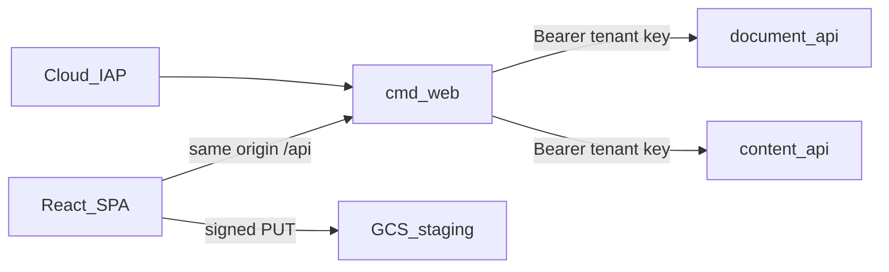

# Production web BFF (same-origin)

Local development keeps using Vite → `yesbook-dev` with the published API key
injected by the Vite proxy. Production puts a Go web service in front so the
browser never holds backend API keys.



## Responsibilities

| Layer | Trust | Credentials |
| --- | --- | --- |
| Browser | User session (IAP cookie / Google identity) | None for APIs |
| `cmd/web` | IAP identity → tenant map | Injects `YESBOOK_API_KEYS` toward backends |
| `document-api` / `content-api` | API key → tenant | Existing `auth.APIKeys` |
| GCS signed PUT | V4 signature + bucket CORS | No browser API key |

## Configuration

| Variable | Required | Purpose |
| --- | --- | --- |
| `YESBOOK_DOCUMENT_API_URL` | yes | Origin of document-api (no path) |
| `YESBOOK_CONTENT_API_URL` | yes | Origin of content-api |
| `YESBOOK_API_KEYS` | yes | Same `tenant:key,...` secret the APIs use (server-side only) |
| `YESBOOK_USER_TENANTS` | yes | `user@domain:tenant,...` map from IAP email to tenant |
| `YESBOOK_WEB_ROOT` | no | SPA directory (default `web/dist`, image sets `/app/web`) |
| `YESBOOK_AUTH_MODE` | no | `iap` (default) or `dev` |
| `YESBOOK_DEV_USER` | when `dev` | Fixed identity for local BFF runs |
| `YESBOOK_IAP_REQUIRE_JWT` | no | Set to `1` to require `X-Goog-IAP-JWT-Assertion` presence |

Do not invent or commit production keys. Create them with your secret manager /
`deploy/setup.sh` and mount them into Cloud Run as secrets.

## IAP / user → tenant mapping

1. Protect the **web** Cloud Run service (or HTTPS LB backend) with
   [Identity-Aware Proxy](https://cloud.google.com/iap/docs/enabling-cloud-run).
2. Grant access to the Google accounts that should use the UI.
3. Set `YESBOOK_USER_TENANTS` so each allowed email maps to exactly one tenant
   that also appears in `YESBOOK_API_KEYS`.
4. Keep document-api / content-api **private** to the web service account
   (`roles/run.invoker`) so browsers cannot call them with stolen URLs alone.
5. Optional hardening: set `YESBOOK_IAP_REQUIRE_JWT=1` and later plug an
   `auth.IAPJWTVerifier` that checks audience against your IAP OAuth client /
   backend service. The default `auth.IAPAuthenticator` trusts the email header
   only when IAP is enforced on ingress (Cloud Run / LB strips client-supplied
   `X-Goog-*` identity headers).

`YESBOOK_AUTH_MODE=dev` trusts `YESBOOK_DEV_USER` / `X-Yesbook-User` for laptop
BFF testing. Never enable it on a public service.

## Signed-upload CORS

Register returns a signed upload URL. The SPA uploads with `PUT` and a
`Content-Type` header:

- **Local Vite proxy:** URLs under `/uploads/` are rewritten to `/api/uploads/…`
  so the browser stays same-origin; no CORS needed.
- **Local absolute localblob URLs:** set `YESBOOK_UPLOAD_CORS_ORIGINS` on
  `yesbook-dev` (defaults include `http://localhost:5173`).
- **Production GCS:** apply CORS on the **staging** bucket only, using the web
  origin (the Cloud Run URL or custom domain):

```powershell
# Edit deploy/gcs-cors.json origins first, then:
gcloud storage buckets update gs://PROJECT-yesbook-staging --cors-file=deploy/gcs-cors.json
```

Required CORS shape: `PUT` + `OPTIONS`, allow `Content-Type` and
`x-goog-content-length-range` request headers, expose length/type as needed.
GCS signed URLs are not rewritten by the SPA (`rewriteLocalObjectURL` only
touches `/uploads/` and `/files/` paths).

## Build and run locally (BFF + backends)

```powershell
Set-Location C:\Users\avi-p\Go_first_project\yesbook
npm --prefix web ci
npm --prefix web run build

# Terminal A: all-in-one API (or separate document/content APIs)
go run ./cmd/yesbook-dev

# Terminal B: same-origin BFF against that process for both upstreams
$env:YESBOOK_DOCUMENT_API_URL = 'http://127.0.0.1:8080'
$env:YESBOOK_CONTENT_API_URL = 'http://127.0.0.1:8080'
$env:YESBOOK_API_KEYS = 'dev-tenant:dev-key-0123456789abcdef'
$env:YESBOOK_USER_TENANTS = 'dev@localhost:dev-tenant'
$env:YESBOOK_AUTH_MODE = 'dev'
$env:YESBOOK_DEV_USER = 'dev@localhost'
$env:YESBOOK_WEB_ROOT = 'web/dist'
$env:PORT = '8090'
go run ./cmd/web
```

Open `http://127.0.0.1:8090`. API calls go to `/api/...`; health is
`/healthz` (probe) and `/api/healthz` (SPA).

## Docker / Cloud Build

```powershell
# Backend images unchanged:
docker build --build-arg CMD=document-api -t yesbook-document-api .

# Web image (frontend + BFF):
docker build -f Dockerfile.web -t yesbook-web .
# or: make docker-build-web
```

`deploy/cloudbuild.yaml` builds `web` with `Dockerfile.web` in parallel with
the existing `CMD=` images.

Deploy sketch (after IAP and secrets exist):

```bash
gcloud run deploy web --image="${REPO}/web:${TAG}" --region="${REGION}" --project="${PROJECT}" \
  --service-account="$(sa web)" \
  --set-secrets="YESBOOK_API_KEYS=yesbook-api-keys:latest,YESBOOK_USER_TENANTS=yesbook-user-tenants:latest" \
  --set-env-vars="YESBOOK_DOCUMENT_API_URL=${DOC_URL},YESBOOK_CONTENT_API_URL=${CONTENT_URL},YESBOOK_AUTH_MODE=iap" \
  --allow-unauthenticated   # IAP still gates users when enabled on the service
```

Grant the web runtime SA `roles/run.invoker` on document-api and content-api,
then remove public `--allow-unauthenticated` from those APIs.

## Remaining production gaps

- Wire a real `IAPJWTVerifier` (audience + Google public keys) instead of
  header presence alone.
- Automate IAP enablement, `yesbook-user-tenants` secret, and web SA in
  `deploy/setup.sh` (hooks are documented; not fully scripted yet).
- Lock down document-api / content-api to private ingress once the BFF is the
  only browser entrypoint.
- Custom domain + managed TLS for a stable CORS origin on the staging bucket.
- Optional: Cloud Armor / rate limits on the web service.
